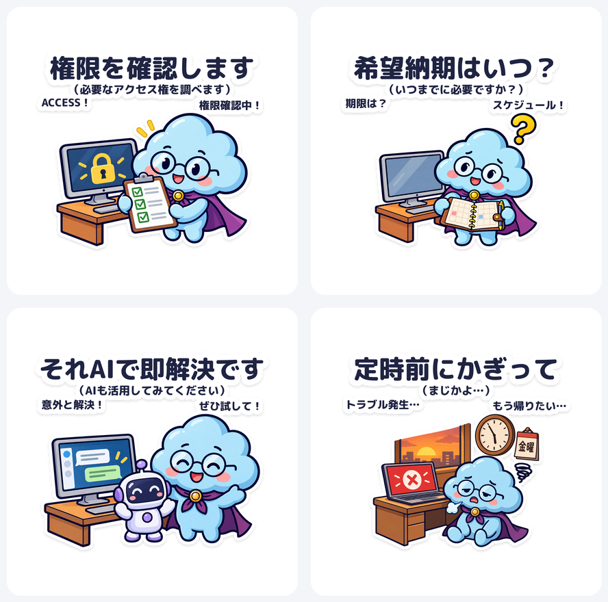
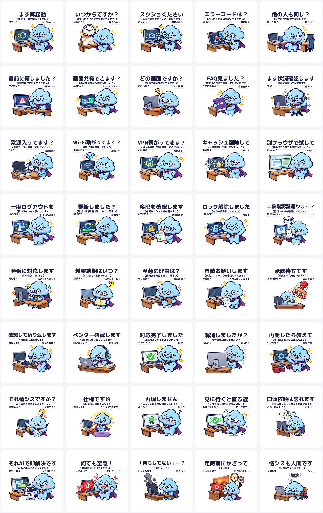

# クラモ君 LINEスタンプ40種類・納品

追加のお手本4枚を基準に制作したNo.01〜40の最新版です。

## Canvaで調整する場合

[Canva用・高解像度PNG40枚をダウンロード](canva-editing-40.zip?raw=true)

ZIPを解凍すると、01.png〜40.pngの個別画像が入っています。1480×1280px、RGBA、背景透過済みです。PNGをCanvaへアップロードし、調整後に申請用サイズで書き出してください。

一覧画像の左上にあった確認用の「No.〇〇」は、すべて削除しました。個別PNGにも確認用番号は表示されません。下の一覧は確認用です。Canvaで使う際は一覧から切り出さず、上記の個別PNGをご利用ください。

## 最新修正（2026-11-02）

- No.18：チェックリストを両手で相手に差し出すポーズへ修正。
- No.22：開いた手帳を両手で相手に見せるポーズへ修正。ペンは外縁に留めています。
- No.36：メイン文字を「それAIで即解決です」に変更。
- No.39：メイン文字を「定時前にかぎって」に変更。

一覧・PNG一式・LINE申請候補・編集用元データに反映済みです。

[No.18](No18.png?raw=true) / [No.22](No22.png?raw=true) / [No.36](No36.png?raw=true) / [No.39](No39.png?raw=true)



## ダウンロード

GitHubにログインした状態で、次のリンクから取得してください。ファイル画面が開いた場合は右上のダウンロードボタンを使用できます。

| ファイル | 内容 | 容量 |
|---|---|---:|
| [Canva調整用・高解像度PNG40枚](canva-editing-40.zip?raw=true) | 番号表示なし・背景透過・1480×1280pxの個別PNG40枚 | 約38MB |
| [PNG40枚・品質レポート](kuramo-40-stickers.zip?raw=true) | 個別PNG40枚、一覧、制作管理表、品質評価、仕様検査 | 約10MB |
| [編集用元データ](kuramo-production-sources.zip?raw=true) | 原寸イラスト・マスター・編集用SVG・フォントとライセンス・プロンプト・スクリプト・修正前画像 | 約101MB |
| [LINE申請候補](line-upload-candidate.zip?raw=true) | 01.png〜40.png、main.png、tab.pngをZIPのルートに配置 | 約5.6MB |
| [一覧画像の原寸表示](all-40.png?raw=true) | 5列×8行、全40種類 | 約4.5MB |

## 全40種類の一覧（番号表示なし）



## 検査結果と注意点

- 個別画像40枚、未完成0枚。370×320pxの透過RGBA PNG。
- 最新の指定メイン文字・サブ文字、形式、容量、透過、外周余白の検査：40/40通過。
- 今回の4枚以外の36枚は、直前の納品データとPNGの内容が一致することを確認。
- 制作者の目視評価：92〜95点。各画像の詳細な所見はPNG一式ZIPのquality-report.csv。
- No.39サブは「（まじかよ…）」、No.40は残量1%を確認。
- LINE公式の最新制作ガイドはHTTP 403で取得できなかったため、申請前の最新要件確認が必要です。LINEへの販売申請・公開は行っていません。

## ファイル整合性

SHA-256は以下のとおりです。

```
32e36f898331ac5a47e7b1bdd1ff1ed62e7733050652db08c7506864c9af41ae  canva-editing-40.zip
3d1749d4dbadadd18980ad4a3c55b2af7e3cadc3204b7a68486e1be6dfaee5ef  kuramo-40-stickers.zip
9644cefa2e3c0ced3774d28a35f8ec755452d750fd358c90268387a2be04b42c  kuramo-production-sources.zip
d1ff3e8cac5bdf6bd3dde2f484284ccb831d143df00e37df921f28089c6bf7e0  line-upload-candidate.zip
6ad17e45a9b3229aec539a426a1fa176a7cb7837a47cc7f96873900186b4608c  all-40.png
8e1b32c19023fcec58b88d9bdcaf978ddff5e33b202364c0d3f79842d3d01dbe  No18.png
c1f48a8a7ccfdc72dd32fe2c29754996b62d49dd00cd409c5c27246a08c4ce37  No22.png
ada4f2f152162ed692f847785490c7f5a9b2cffa3381d81cdaa9c76ae5c96992  No36.png
09c7ec226609fd8617e581502f9687970eec8ec25efcfdb01f71201c2de2f23a  No39.png
5cab57e11772cac7ee225846ef0894ca326caff64d5617a94f35594e9dd1c17a  revised-18-22-36-39.png
```
